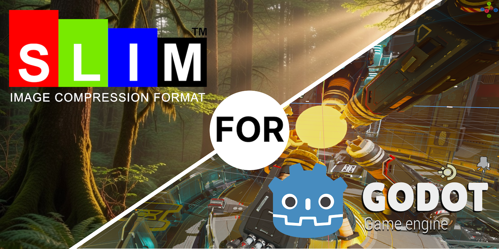
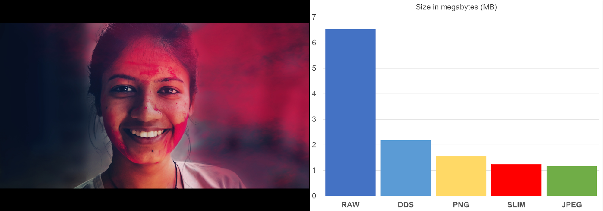

# GODOT SLIM Textures
**GODOT SLIM Textures** – This is a module for loading textures in **SLIM** format.



# SLIM
**SLIM (SLeptsov IMage)** – This is an image encoding and compression format developed as a replacement for the DDS format. This format is designed for storing raster graphics and supports resolutions up to 65535x65535 pixels. It uses lossless compression algorithms (**RLE**, **RICE**, **SLDD**, **MASKARED**) and also employs a smart quantization algorithm.

# Building Godot with the GODOT SLIM Textures Module

A quick guide on how to add the **GODOT SLIM Textures** module (loading textures in the **SLIM** format) to the Godot source code and build the engine with its support.

The module is native and is compiled directly into the engine, so you must build Godot from source (an official pre-built binary will not work). The same applies to **export templates**: a finished game always runs on the template binaries, not on the editor, so the module must be compiled into the templates too — official templates will not load `.SLIM` textures. That is why this guide builds the editor and the export templates in one pass.

---

## 1. What you need

- **Python 3** — to run the build system ([python.org](https://www.python.org/downloads/));
- **SCons** — Godot's build system, installed with a single command:

  ```bash
  pip install scons
  ```
- **A C++ compiler:**

  | OS | What you need |
  |---|---|
  | Windows | Visual Studio 2022 Community (the "Desktop development with C++" workload) **or** MinGW-w64 |
  | Linux | GCC or Clang: `sudo apt install build-essential pkg-config` |
  | macOS | Xcode Command Line Tools: `xcode-select --install` |
- **The Godot source code** — the version the module is compatible with;
- **The GODOT SLIM Textures module source code**.
- **The toSLIM utility source code** — to create or convert textures to the SLIM format ([github.com/VERTEXSoftware/toSLIM](https://github.com/VERTEXSoftware/toSLIM)) — see section 5.

---

## 2. Get the Godot source code

```bash
git clone https://github.com/godotengine/godot.git
cd godot
```

> **Important:** the module version and the engine version must match. See the module's README/releases to find out which tag you need.

---

## 3. Add the module to the Godot source tree

All native modules live in the `modules/` directory of the Godot source tree. Copy the module folder there — the folder name is the module name (for example, `godot_slim_textures`):
After copying, check that the required module files are in place:

```
godot/
└── modules/
    └── godot_slim_textures/
```

If these files are present, you are done. Any folder inside `modules/` that contains an `SCsub` and a `config.py` is picked up automatically — **you don't need to modify any of Godot's global configs**.

> **Alternative:** in Godot 4.1+ you can skip copying and pass the module path at build time instead:
>
> ```bash
> scons platform=linuxbsd custom_modules=/path/to/godot-slim-textures
> ```

---

## 4. Build the engine and the export templates

Run `scons` **from the root of the Godot source tree**. One build pass compiles three binaries from the same source tree, and the module is built into every one of them:

| Target | What it is | What it is used for |
|---|---|---|
| `target=editor` | The editor binary | Developing the project in the editor |
| `target=template_release` | The release export template | Shipping the finished game |
| `target=template_debug` | The debug export template | Debugging the exported game |

Build **all three targets**: the editor alone is enough for development, but a game exported with official templates will not contain the module. A full build takes 10 to 40 minutes depending on your CPU.

**Windows (MSVC):**

```bash
scons platform=windows target=editor -j8
scons platform=windows target=template_release -j8
scons platform=windows target=template_debug -j8
```

**Windows (MinGW):**

```bash
scons platform=windows target=editor mingw=yes -j8
scons platform=windows target=template_release mingw=yes -j8
scons platform=windows target=template_debug mingw=yes -j8
```

**Linux:**

```bash
scons platform=linuxbsd target=editor -j8
scons platform=linuxbsd target=template_release -j8
scons platform=linuxbsd target=template_debug -j8
```

**macOS:**

```bash
scons platform=macos target=editor -j8
scons platform=macos target=template_release -j8
scons platform=macos target=template_debug -j8
```

The resulting binaries appear in the `bin/` directory:

```
bin/godot.windows.editor.x86_64.exe             # Windows
bin/godot.windows.template_release.x86_64.exe   # Windows
bin/godot.windows.template_debug.x86_64.exe     # Windows
bin/godot.linuxbsd.editor.x86_64                # Linux
bin/godot.linuxbsd.template_release.x86_64      # Linux
bin/godot.linuxbsd.template_debug.x86_64        # Linux
bin/godot.macos.editor.arm64                    # macOS
bin/godot.macos.template_release.arm64          # macOS
bin/godot.macos.template_debug.arm64            # macOS
```

The editor binary is ready to use as is — the module is already built into it. The templates need one more step: installing them (see 4.1).

### Install the export templates

Copy the template files from `bin/` into the templates folder for your version of Godot:

- Windows: `%APPDATA%\Godot\export_templates\<version>\`
- Linux: `~/.local/share/godot/export_templates/<version>/`
- macOS: `~/Library/Application Support/Godot/export_templates/<version>/`

`<version>` is the engine version folder, for example `4.3.stable` — the same name the official templates of that version use. If you are not sure about the exact name, try exporting once without templates: the editor prints the exact expected path in the error message. If official templates for the same version are already installed there, replace them — they do not contain the module.

Rename the copied files to the names the export system expects:

| Built file (bin/) | Install as |
|---|---|
| `godot.windows.template_release.x86_64.exe` | `windows_release_x86_64.exe` |
| `godot.windows.template_debug.x86_64.exe` | `windows_debug_x86_64.exe` |
| `godot.linuxbsd.template_release.x86_64` | `linux_release.x86_64` |
| `godot.linuxbsd.template_debug.x86_64` | `linux_debug.x86_64` |
| `godot.macos.template_release.arm64` | pack the binary into a `Godot.app` bundle inside a `macos.zip` archive |

For Godot 3.x builds the names differ (`windows_release_64.exe` / `windows_debug_64.exe`, `x11_release_64` / `x11_debug_64`); for other platforms and details, see the official Godot documentation ("Exporting projects" section).

> **Shortcut:** instead of installing templates globally, you can keep them in `bin/` and point each export preset's **Custom Template** directly at these files (see section 6).

---

## 5. Build the toSLIM utility (create .SLIM textures)

The module only **loads** `.SLIM` textures — it does not import other image formats. To create new `.SLIM` files, or to convert existing textures (**PNG**, **JPG/JPEG**, **GIF**, **BMP**, **PIC**) to the SLIM format, build the **toSLIM** converter from its own repository:

```bash
git clone https://github.com/VERTEXSoftware/toSLIM.git
cd toSLIM
```

**Installing dependencies (Linux):**

```bash
# Debian/Ubuntu
apt update
apt install build-essential make cmake
apt install libx11-dev libxext-dev libxrandr-dev libxi-dev libxcursor-dev libxinerama-dev libxss-dev libgl1-mesa-dev

# Arch Linux
pacman -Syu
pacman -S base-devel make cmake
pacman -S mesa libx11 libxext libxrandr libxi libxcursor libxinerama libxss
```

**Default build (graphical mode):**

```bash
make
```

**Terminal mode only build (no GUI — enough for converting textures):**

```bash
make terminal
```

> **Note:** the graphical viewer uses SDL2, and on some systems you may need to compile SDL2 manually — see the toSLIM repository for details. The tool's README documents the Linux build; for other platforms, follow the SDL2 build instructions there.

**Converting a texture to the SLIM format:**

```bash
toslim -c texture.png texture.SLIM          # convert PNG → SLIM
toslim -c -q 255 texture.png texture.SLIM   # quality 0–255; 255 = lossless / maximum quality
toslim -i texture.SLIM                      # show information about a .SLIM file
```

---

## 6. Verify that the module works

1. Launch the built editor from `bin/`.
2. Import a `.SLIM` texture file into a test project.
3. If the texture loads and displays correctly, the module was built and works.

---

## 7. Export a project with the export templates

With the editor and the templates built as above, exporting a game requires no extra tools:

1. Launch the built editor from `bin/` and open your project.
2. Check the templates: **Editor → Manage Export Templates** — there should be no warning about missing templates for the current version. If there is, install the templates as described in section 4.1.
3. Open **Project → Export** and click **Add…** to create a preset for the target platform (Windows Desktop, Linux, macOS, etc.).
4. Configure the preset: name, architecture, and the platform options you need.
5. If you skipped section 4.1, expand **Custom Template** in the preset and point **Release** / **Debug** directly at the template files built in section 4.
6. Click **Export Project…** and choose the output file. Leave **Export With Debug** unchecked for a release build (checked exports use the debug template).
7. Run the exported game and load a project with a `.SLIM` texture — if the texture displays, the module is present in the finished game as well.

> **Note:** **Export PCK/ZIP** packs only the game data; the engine executable always comes from the export templates — which is exactly why the module must be built into them (section 4).

---

## 8. Common issues

| Problem | Solution |
|---|---|
| `scons: command not found` | Run `pip install scons` and make sure the Python/Scripts folder is in `PATH` (Windows) |
| SCons can't find Visual Studio | Run the build from the **"x64 Native Tools Command Prompt for VS 2022"** console |
| Module compilation errors | Make sure the Godot tag matches the version the module was written for |
| Module is "not picked up" | Verify that the module folder contains `SCsub` and `config.py` |
| Building for Godot 3.x | Use `platform=x11` instead of `platform=linuxbsd`, and `target=release_debug` instead of `target=editor` |
| Exported game doesn't load `.SLIM` textures | The game was exported with templates without the module (official templates were used). Rebuild and install the templates (sections 4 and 4.1) or point the preset's **Custom Template** to the files from `bin/`, then export again |
| `toSLIM` build fails / SDL2 errors | Install the dependencies from section 5, or build the terminal-only version (`make terminal`) if you only need conversion; on some systems SDL2 must be compiled manually — see the toSLIM repository |

---

## License

This project is licensed under the [MIT License](LICENSE).

Copyright (c) 2026 Sleptsov Vladimir
